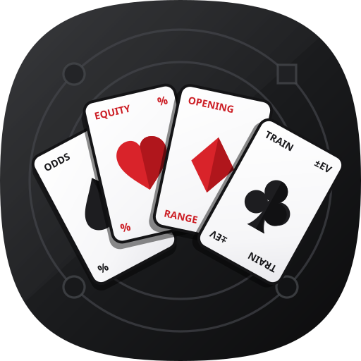

# ♠️ Poker Trainer

  

<h1 align="center">Poker Trainer</h1>

  Allenati nel Texas Hold'em: Opening Range, Outs, Equity e Pot Odds.

## 📱 Screenshot

  
  

## 🎯 Il progetto

Poker Trainer è un'applicazione realizzata con Flutter per imparare e migliorare le decisioni nel Texas Hold'em.

È pensata per giocatori principianti e intermedi che vogliono comprendere meglio le decisioni preflop e postflop attraverso esercizi casuali, calcoli matematici e situazioni di gioco.

L'obiettivo è sviluppare un metodo di ragionamento applicabile anche alle partite reali, senza richiedere conoscenze da giocatore professionista.

## 🃏 Funzionalità principali

### 1. Preflop Opening Range Trainer

- Generazione casuale delle mani iniziali.
- Valutazione delle decisioni in base alla posizione.
- Range personalizzati per differenti configurazioni del tavolo.
- Allenamento con scenari e situazioni differenti.
- Spiegazioni contestuali per comprendere le decisioni.

### 2. Outs & Equity Trainer

- Esercizi casuali con flop e turn.
- Riconoscimento di Flush Draw, Straight Draw, Gutshot, OESD e Combo Draw.
- Conteggio degli outs.
- Distinzione tra outs puliti e sporchi.
- Applicazione della regola del 4 e del 2.
- Riconoscimento delle mani già formate e dei board pericolosi.

### 3. Pot Odds Trainer

- Simulazione di differenti dimensioni del piatto e puntate.
- Calcolo dell'equity richiesta per chiamare.
- Valutazione delle decisioni Call/Fold.
- Gestione delle situazioni di All-in.
- Esercizi basati su stack e dimensioni delle puntate.

## 📊 Come funzionano i calcoli

Il trainer utilizza formule e approssimazioni pensate per facilitare l'apprendimento.

**Regola del 4 e del 2**
- Flop: numero di outs × 4 per stimare la probabilità di migliorare entro il river.
- Turn: numero di outs × 2 per stimare la probabilità di migliorare al river.

**Pot Odds**

L'equity richiesta per chiamare viene calcolata confrontando la somma da aggiungere con il piatto finale.

**All-in**

La soglia dipende dalle pot odds effettive e non da una percentuale fissa.

Nei tornei, il rischio di eliminazione e il valore dei premi possono richiedere valutazioni ulteriori, come l'ICM, non calcolato dall'app.

**Nota didattica:** le stime degli outs e dell'equity sono strumenti di allenamento, non calcoli esatti contro un range avversario. La qualità della decisione reale dipende anche dalle mani possibili dell'avversario e dal suo stile di gioco.

## 📲 Installazione

### PWA – Android
Apri l'app con Chrome e seleziona "Installa app" oppure "Aggiungi a schermata Home".

### PWA – iOS
Apri l'app con Safari, premi Condividi e seleziona "Aggiungi alla schermata Home".

### PWA – PC
Apri l'app con Chrome o Edge e utilizza l'icona di installazione nella barra degli indirizzi, se disponibile.